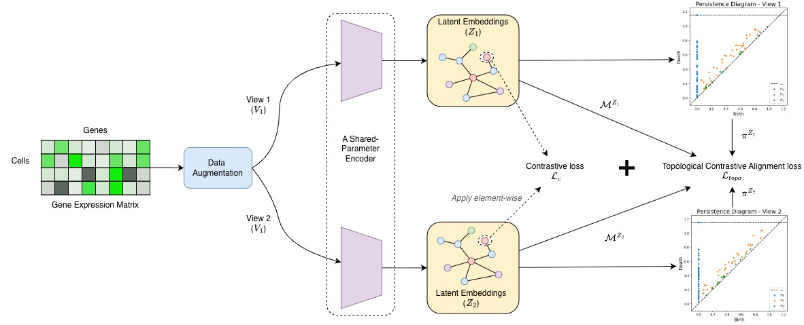

# Enhancing Contrastive Learning with Topology Alignment: A Key for Novel Single-cell RNA-seq Clustering

---

This repo proposes code for Topology regularization for contrastive learning in scRNA-seq data clustering. Beside, experiments on 6 models (contrastive-sc, scCCL, scNAME, scGPCL, scMMN, and scAGCL) are included, where this topology regularization is added into their training.

## Abstract


Unsupervised clustering is a critical step for identifying cell types and novel subpopulations from high-dimensional single-cell RNA-sequencing (scRNA-seq) data. While contrastive learning has emerged as a powerful tool for learning scRNA-seq representations, current instance-level loss objectives optimize for local similarity at the expense of global manifold structures. We propose a novel regularization strategy that integrates topological constraints into contrastive frameworks by aligning the persistent homology of data views. By evaluating our method across 24 empirical scRNA-seq datasets, we demonstrate that topological penalization significantly improves clustering performance (measured via ARI and NMI) when applied to multiple distinct baseline architectures. Furthermore, these topology-refined models consistently outperform current state-of-the-art baselines. This approach introduces a highly generalizable, model-agnostic loss function that preserves global cellular trajectories, establishing a robust new standard for deep single-cell clustering.




## Topology Signature Loss function


**Topological Contrastive Alignment**. Let $Z_1$ and $Z_2$ denote the latent embeddings generated by the encoder from two augmented views, with corresponding pairwise distance matrices $\mathcal{M}^{Z_1}$ and $\mathcal{M}^{Z_2}$. Independently applying the Vietoris-Rips filtration to each distance matrix yields two distinct filtrations. Computing the persistent homology of these filtrations produces the persistence diagrams $PD^{Z_1}$ and $PD^{Z_2}$, alongside their respective sets of critical edge indices $\pi^{Z_1}$ and $\pi^{Z_2}$. 

Let $\Pi = \pi^{Z_1} \cup \pi^{Z_2}$ denote the combined multiset of all critical edge indices from both augmented views. The topological contrastive alignment loss can be defined over this combined set: $\mathcal{L}_{topo}(Z_1, Z_2) = \frac{1}{2} \| \mathcal{M}^{Z_1}[\Pi] - \mathcal{M}^{Z_2}[\Pi] \|^2$


## Project contents

 
- `utils/`: contains preprocessing code and other supported functions.
- `experimental_notebooks/`: contains experimental codes of 6 scRNA-seq models that are copied directly from authors' repo. `ToplogySignatureLoss` is added into their training to improve clustering result.
- `topology_signature.py`: Contains `TopologySignatureLoss` function that use Persistence Homology to refine code

## Experimental Models


We run the experiments on 6 contrastive-based model for scRNA-seq data clustering:

| Model | Paper | Github Source |
| -- | -- | -- |
| contrastive-sc | Contrastive self‑supervised clustering of scRNA‑seq data | [ciortanmadalina/contrastive-sc](https://github.com/ciortanmadalina/contrastive-sc) |
| scCCL | ScCCL: Single-Cell Data Clustering Based on Self-Supervised Contrastive Learning | [LuckyxiaoLin/ScCCL](https://github.com/LuckyxiaoLin/ScCCL) |
| scNAME | scNAME: neighborhood contrastive clustering with ancillary mask estimation for scRNA-seq data | [aster-ww/scNAME](https://github.com/aster-ww/scNAME) |
| scGPCL | Deep single-cell RNA-seq data clustering with graph prototypical contrastive learning | [Junseok0207/scGPCL](https://github.com/Junseok0207/scGPCL) |
| scMMN | Multi-level multi-view network based on structural contrastive learning for scRNA-seq data clustering | [szq0816/scMMN](https://github.com/szq0816/scMMN) |
| scAGCL | Deep clustering of single-cell RNA-seq using adversarial graph contrastive learning | [levinhcntt/scAGCL](https://github.com/levinhcntt/scAGCL) |

## Datasets

 

The `h5` files versions of 24 datasets used in this paper can be found in [Kaggle](https://www.kaggle.com/datasets/trungtranhcmut/scrna-seq-datasets-topology-contrastive-learning). The references for each of those datasets are shown in the main paper.

## Setup

Python version requirement: `python==3.11`

To install the package used in project:
```
pip install -r requirement.txt
sh aleph_install.sh
```

## Running Experiments

 

The experiments can be run by notebooks, which can be found in `experimental_notebooks`. For arguments and options, please refer to each notebook for rerun experiments.

## Authors


Author email: [qtrung.tran2004@gmail.com](mailto:qtrung.tran2004@gmail.com)